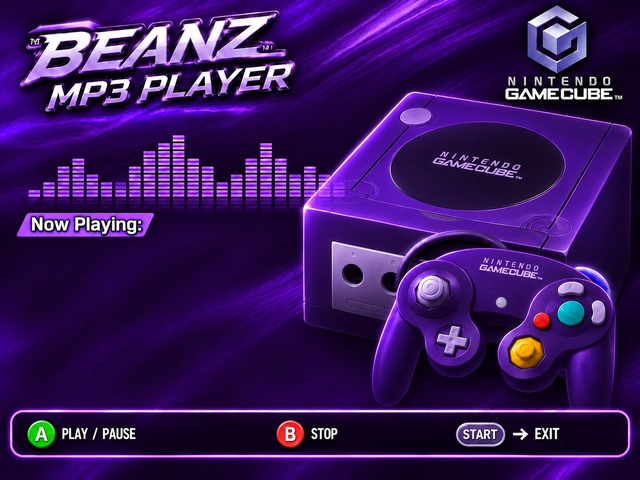
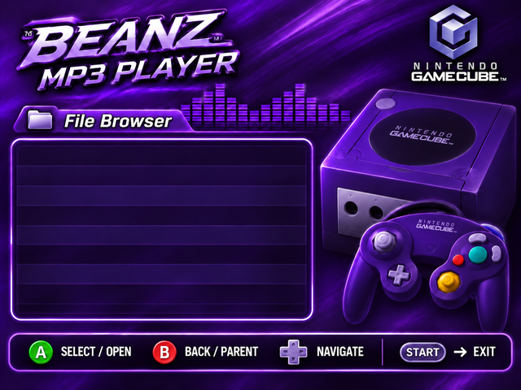

# BEANZ MP3 Player

**Version 1.0 — Nintendo GameCube homebrew**

BEANZ MP3 Player is a lightweight music player for the original Nintendo GameCube. Browse MP3 files on SD storage and play them through a custom GameCube-themed interface.



## Features

- MP3 playback with the bundled [minimp3](https://github.com/lieff/minimp3) decoder and libogc ASND audio.
- Browse folders and MP3 files on compatible SD2SP2 or SD Gecko storage through libfat.
- Seven-row file browser with safe navigation at the active storage root.
- Now Playing screen with scrolling filenames, track number, elapsed time, and total duration.
- Pause, resume, stop, and return to the file browser.
- Automatic return to the file browser when a song ends.
- Audio-buffer retry handling for temporary ASND queue rejections.
- Custom Now Playing and File Browser wallpapers.



## Controls

| Screen | Button | Action |
| --- | --- | --- |
| File Browser | D-pad Up / Down | Move selection |
| File Browser | A | Open folder / Play MP3 |
| File Browser | B | Go to parent folder |
| Now Playing | A | Pause / Resume |
| Now Playing | B | Stop and return to File Browser |
| Both | START | Exit to homebrew loader (e.g. Swiss) |

The player focuses on one song at a time. It does not include seeking, track skipping, playlists, repeat, shuffle, or automatic next-song playback.

## Preparing MP3 files (optional)

Need to convert audio to MP3? You can use **[YT2MP3](https://github.com/nxs8739/yt2mp3)**, a separate conversion tool by BEANZ:

- **Online converter (Windows, Linux, and other platforms):** [YT2MP3 Web](https://yt2mp3.bsllc.xyz/) — convert through your web browser.
- **Linux AppImage (x86_64):** [YT2MP3 v1.3 AppImage Release](https://github.com/nxs8739/yt2mp3/releases/tag/v1.3) — download the AppImage to run the converter on your own Linux computer. The first launch requires an internet connection to install its Python dependencies.

YT2MP3 targets **192 kbps MP3** output. It is **optional**: BEANZ MP3 Player can play compatible MP3 files made with other tools, too. Only convert content you have permission to use.

## Requirements

**To run:**
- Original Nintendo GameCube capable of launching homebrew (for example, through Swiss).
- Compatible FAT-formatted SD storage via SD2SP2 or SD Gecko.
- MP3 audio files.

**To build:**
- devkitPPC GameCube toolchain
- libogc **3.2.1** with ASND
- libfat

## Build

From the project directory, run:

```bash
make clean && make
```

The resulting `beanz-mp3-player.dol` can be copied to SD storage and launched through your homebrew loader. Keep your MP3 files in folders on the SD card as desired.

## Source layout

```text
Makefile                         GameCube build instructions
source/main.c                    File browser, GX UI, and controls
source/mp3_audio.c / .h          MP3 decoding and ASND playback
source/minimp3.h                 Bundled MP3 decoder (CC0)
source/wallpaper.c               Embedded Now Playing wallpaper
source/browser_wallpaper.c       Embedded File Browser wallpaper
assets/                          Preview images of both wallpapers
test-harness/                    Optional host-side audio regression tests
```

## Developer test harness

The optional `test-harness/` directory provides ASND mocks for checking audio queue retries and playback-state behavior. Instructions are in `test-harness/README.txt`.

## License and attribution

The original application source code is licensed under **MIT**; see [LICENSE](LICENSE). The bundled **minimp3** decoder is under **CC0 1.0**; see [THIRD_PARTY_NOTICES.md](THIRD_PARTY_NOTICES.md) for details and artwork/trademark notices.

BEANZ MP3 Player is an unofficial homebrew project, not affiliated with or endorsed by Nintendo.

Project direction, design, and console testing: **BEANZ**. Source implementation included AI assistance.

**Simple by design. Reliable by implementation!**
